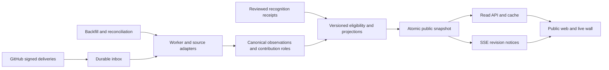

<!-- Generated by scripts/render_docs.py; edit planning JSON or this renderer. -->

# Proposed service architecture

This is the architecture and delivery baseline. Local runtime implementations now exist in `apps/` and `packages/`; the [runtime guide](runtime-foundation.md) lists the current workspaces and validation path. The planned module boundaries below are not an inventory of completed work. Each module's acceptance belongs to its linked delivery work packages, including their source, production and operational evidence gates.

TypeScript modular application with React/Vite static frontend, API/webhook service, background workers and PostgreSQL-backed durable inbox/outbox; scale components independently only when measured load warrants it.

## Proposed modules

| Location | Responsibility |
| --- | --- |
| apps/web | Public boards, directory, profiles, evidence and live wall; authenticated console lazily separated |
| apps/service | Read APIs, SSE snapshot notices, webhook receiver and protected mutations |
| apps/worker | Backfill, enrichment, classification, reconciliation and aggregate projection |
| packages/contracts | Versioned leaderboard schemas and client types |
| packages/github | Permission-aware source adapters and pagination |
| packages/metrics | Pure definitions, counting, dedupe and policy evaluation |
| packages/ui | Accessible brand components |
| infra | Host-neutral configuration, migrations and runbooks |
| tests/fixtures | Synthetic and sanitized edge-case data; no real emails or secrets |

Use PostgreSQL-backed leases and an outbox initially. Add a separate broker or cache only through a measured architecture decision. Database migrations, replay compatibility and projection versions must be exercised before changes reach production.

## Data boundaries

- installations
- repository_scope_versions
- projects
- actors
- identity_aliases
- source_objects
- source_observations
- webhook_deliveries
- canonical_events
- event_observation_links
- relation_edges
- artifact_lineage
- contribution_roles
- recognition_receipts
- metric_definitions
- eligibility_decisions
- corrections
- coverage_intervals
- sync_cursors
- outbox
- aggregate_revisions
- public_projections
- moderation_audit

Canonical observations retain source identity, action, actor, subject, occurrence time, observation time, visibility, deduplication key and source revision. Identity aliases do not rewrite past roles. Event receipts and public projections are separate so access changes, opt-outs and corrections can retract all visible derived values.

## Public API

Read routes serve revisioned snapshots with explicit source coverage, filters, time bounds and policy version. Cache keys include those dimensions. Cursor pagination and deterministic tie ordering prevent skipped or repeated contributors. SSE publishes revision notices; clients refetch data through the API and use conditional polling if disconnected. Preserve reading position and hold reordered results until a user applies them.

Protected mutation endpoints cover corrections, opt-out, profile preferences, evidence review and policy administration. They require approved authentication, authorization, request validation, conflict handling and an audit trail. Never expose installation credentials to the browser.

## Trust boundaries

- Store only minimum needed source payload fields by default. If short-lived raw delivery quarantine is used, encrypt it, restrict access and expire it under a published retention policy.
- Long-lived ledger stores public/minimized evidence and hashes, not full private raw payloads.
- Secrets in managed secret store, scoped short-lived installation tokens and rotated webhook secrets; no credentials in browser or public build environment.
- Untrusted titles, Markdown, URLs, filenames and diffs never execute. Escape rendering, sanitize URLs/Markdown, prevent formula injection in CSV exports and validate open redirects.
- Outbound hydration targets GitHub API or approved static artifacts only; arbitrary user URL fetch requires SSRF protection and separate worker.
- Public API cache keys include scope/definition version and cannot expose admin/private projections. Admin requires organization-approved authentication, authorization and audit.
- Separate production/staging apps, databases and public hostnames. Canary/test events are marked synthetic and never contribute to real rankings.

## Proposed targets

| Area | Target requiring measurement |
| --- | --- |
| webhook_ack_p95 | <2 seconds after durable write |
| received_to_publication_p95 | <60 seconds under agreed test load |
| reconciliation | 5-15 minute recent-window scans and daily rotating completeness audits, budget-adaptive |
| availability_rto_rpo | Evaluate release-gates/v1 targets in planning/release-manifest.json; actual host, budget, operating acceptance and measured results remain required before commitments |

These targets are proposals. A production SLO, retention policy, capacity envelope, incident owner, budget and recovery objective require accepted decisions and operational tests. A documentation build cannot satisfy those gates.
