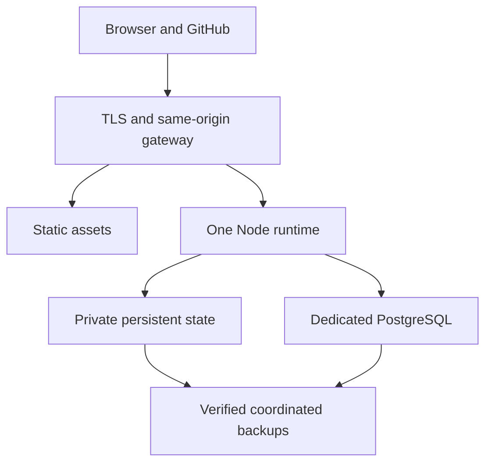

# Initial hosting architecture

Decision: **hosting-topology/v1**, for [LB-01.04](https://github.com/Pick-Your-AI/pick-your-ai-leaderboard/issues/25).
Provider documentation checked **2026-10-18–19**. Review and merge adopt the
engineering design below under the project owner's delegated authority. Actual
provisioning, source activation and release retain their existing gates.

## Selected boundary

Use the dedicated **Pick-Your-AI/pick-your-ai-leaderboard** repository and the
configured **leaderboard.pickyour.ai** public origin. Select a **DigitalOcean
Droplet with a direct, project-controlled nginx HTTPS edge** and one dedicated
managed PostgreSQL database **per environment**, initially in **Frankfurt**.
Staging and production have separate virtual machines, databases, persistent
state, credentials and unpeered VPC networks. This is a concrete planning
selection, not an existing hosting account, paid capacity reservation, measured
sizing result or live URL. The reason for selecting a controllable edge is the
existing public URL capacity contract, explained below.

The provider's [regional availability](https://docs.digitalocean.com/platform/regional-availability/)
lists the selected VM, shared-CPU PostgreSQL and daily backups in Frankfurt
(`FRA1`). Account quotas and immediately available capacity still require actual
provisioning readback.

The application service contains the built static frontend and one Node.js 24
runtime instance. The same-origin nginx gateway forwards the public API,
authenticated controls and signed webhook routes to their existing loopback
listeners. The pipeline, collection scheduling, controls and publication readers
share that instance's private SQLite store. PostgreSQL retains the durable
inbox/outbox, source state and pipeline records. Keep the currently tested
PostgreSQL **17** major version for the first deployment; the selected provider
supports it, and the repository's [local database](../compose.yaml) already selects it.

The gateway and deployable protected host module are still implementation work in
[#48](https://github.com/Pick-Your-AI/pick-your-ai-leaderboard/issues/48). Existing
`npm run dev:*` commands and `compose.yaml` are development entry points. They
must not be presented as a ready production deployment. The
[worker entrypoint](worker-entrypoint.md) accepts a reviewed protected host module
and supplies no default source authorization or listener setup.

## Why one runtime instance

The source reviewed for this decision is accepted
[`97e58618`](https://github.com/Pick-Your-AI/pick-your-ai-leaderboard/tree/97e58618431279544a5d867f7aaf0dec73ab2b52).
[ControlStore](../apps/controls/src/store.mjs) uses synchronous SQLite transactions;
its publication hook must write through that same database transaction.
[createPipeline](../apps/pipeline/src/runtime.mjs) receives the controls store and
SQL adapter, binds public/webhook/control listeners, and drains workers before
the host closes its stores. Policy previews, public confirmation and
[derived retirement](pipeline-derived-retirement.md) also depend on this private
state. A remote callback or second independently initialized store would change
those reviewed boundaries.

The [filesystem checkpoint store](../packages/github/src/checkpoints.ts) also
coordinates repository work within one process. Its locks do not serialize
independent workers. Keep one runtime instance and one collection scheduler;
adding replicas or separate writers requires a reviewed persistence/invalidation
redesign and new concurrency evidence. Plan maintenance downtime for the initial
single-instance topology.

Place private durable state under `/var/lib/leaderboard` on the VM's persistent
filesystem. Keep executable host code and its protected parent directories
separate from mutable data. The host configuration must explicitly bind:

| State | Required placement and recovery rule |
| --- | --- |
| SQLite databases and their journals | `/var/lib/leaderboard/controls/`; back up consistently with PostgreSQL and restore suppression/correction authority before opening readers |
| Collector checkpoint payloads | `/var/lib/leaderboard/checkpoints/`; preserve acknowledged progress across restarts and apply the approved payload retention policy |
| Repository-retirement tombstones | `/var/lib/leaderboard/checkpoint-authority/`; a private sibling **outside** the payload namespace, retained independently of cache expiry or payload restoration |

Every client and restart must use the same authority directory. Restoring older
checkpoint payloads must never replace current retirement authority with an
older copy. The [checkpoint-retirement contract](repository-checkpoint-retirement.md)
explains why missing or relocated tombstones can otherwise re-enable retired
data. Inventory any additional enabled private store or Git mirror before
deployment; an unlisted durable store is a recovery-manifest failure.

## Options considered

| Option | Fit and decision |
| --- | --- |
| Existing website/cPanel runtime | The [current website architecture](https://github.com/Pick-Your-AI/pick-your-ai-website/blob/5afc6a88ffafbb8ca7e411638009319dafc6f1e4/docs/ARCHITECTURE.md) specifies a static SPA on Apache/PHP hosting with no Node runtime. Preserve that contract. It cannot host these long-lived services as currently described. |
| Existing approved shared service infrastructure | No usable service allocation, capacity receipt or accepted operating roster is identified in the current #25 record or decision register. Reuse can be reconsidered when those concrete inputs exist; it is not assumed to be free or available. |
| Separate static site, independent managed API and worker | A useful future topology after durable cross-process coordination is implemented. Splitting the present SQLite-dependent services would break the selected storage boundary. A separate static origin also adds routing, cookie and CORS work without removing that dependency. |
| DigitalOcean virtual machine plus managed PostgreSQL | Selected. Its direct IP endpoint permits the project to configure the ingress URL budget while preserving private filesystem state and managed SQL. OS patching, nginx/TLS maintenance, process supervision and host recovery remain explicit operator duties. |
| One paid Render application service plus managed PostgreSQL | Rejected for the initial selection because its documented Cloudflare edge has an unresolved conflict with the accepted URL capacity. Its disk contract also requires one service instance, prevents a separate worker from sharing that disk and imposes deployment downtime. A Render-specific supported exception and actual maximum-scope readback would be needed before reconsideration. |
| Periodically generated static-only prototype | Suitable only for explicitly periodic/synthetic demonstrations. It does not deliver signed ingestion, protected controls or the live service in the current scope. |

## Ingress must preserve the supported URL capacity

The accepted [public service](../apps/service/src/app.ts) admits request targets
up to **48 KiB**, with separate 16 KiB retained-header and 1,000-header limits.
The existing [native HTTP scope tests](../apps/service/test/public-scope-capacity.test.mjs)
exercise valid maximum-scope v2 and v3 board URLs of **40,667** and **40,767**
bytes at the reviewed commit. All three focused scope tests passed in an isolated
Node.js 24.19.0 build during this decision review. This is synthetic local source
evidence, not deployed-provider evidence.

[Render's DDoS documentation](https://render.com/docs/ddos-protection) says web
services automatically use Cloudflare. [Cloudflare's documented edge behavior](https://developers.cloudflare.com/support/troubleshooting/http-status-codes/4xx-client-error/error-414/)
rejects URIs above 32 KB. Taken together, these documents indicate a material
host-fit risk: the edge could reject a valid scope before the application gateway
sees it. No Render endpoint was provisioned or probed, and no provider-specific
exception has been established. A gateway behind that edge cannot fix an upstream
ceiling. Reducing the supported Project scope to fit the provider would require a
separate reviewed contract change and is not part of this decision.

Use a DNS record pointing directly to the Droplet's endpoint, as supported by the
provider's [subdomain routing](https://docs.digitalocean.com/products/networking/dns/how-to/add-subdomain/).
Its [automatic network DDoS protection](https://docs.digitalocean.com/platform/ddos-protection/)
operates at layers 3 and 4, not HTTP layer 7. These documented boundaries support
the direct-origin design; they do not constitute a measured deployed URL pass.
Do not add a CDN, application load balancer or HTTP proxy until its full ingress
contract is qualified. Configure nginx's
[`large_client_header_buffers`](https://nginx.org/en/docs/http/ngx_http_core_module.html#large_client_header_buffers)
to admit the complete request line; its default 8 KiB buffer is insufficient.
`4 64k` is the initial configuration to validate, with the application's separate
48 KiB target and 16 KiB retained-header limits unchanged. Validate the pinned
nginx version over each enabled HTTP version, including HTTP/1.1 and HTTP/2, with
maximum valid scopes, cursor pagination, oversized targets and oversized headers.
Actual staging DNS/TLS/proxy readback is a release gate, not established by this
configuration proposal.

## Public routes, network and secrets

Expose only the HTTPS gateway and its required certificate-validation/redirect
HTTP route publicly; bind internal listeners to loopback. Preserve request methods,
raw signed webhook bytes, cookies, origin checks and response streaming. The
gateway must give `/api/v1` and protected routes priority over the SPA fallback,
apply the existing request limits, and leave API/control responses out of shared
static caches. Test the actual SSE/proxy behavior before release.

Use the same region's private database URL, authenticated TLS and distinct
least-privilege database credentials. Follow the provider's
[PostgreSQL security guidance](https://docs.digitalocean.com/products/databases/postgresql/how-to/secure/)
with certificate and hostname verification (`verify-full` and the supplied CA
for the selected Standard Edition); do not disable verification. Restrict database
trusted sources to the exact environment's application and separately accepted
maintenance access; do not allow the entire public Internet or all account
resources. Cloud Firewalls protect the VMs, while managed databases use their
own trusted-source controls. Use explicit separate, unpeered
[VPC networks](https://docs.digitalocean.com/products/networking/vpc/details/features/),
not a shared regional default, and verify staging cannot reach production's
private stores.
Environment names alone provide no isolation. Tokens, private host configuration
and webhook secrets belong only to
runtime secret storage; no `VITE_*` value or frontend artifact may contain them.

The original `contributors.pickyour.ai` candidate would provide the same separate
service boundary, but the project owner's [recorded domain selection](https://github.com/Pick-Your-AI/pick-your-ai-leaderboard/issues/25#issuecomment-6242980289)
chooses `leaderboard.pickyour.ai`. Do not introduce an additional active alias or
change that selected origin through this infrastructure decision.

The existing website's `/contributors` integration should be an ordinary link or
redirect to the selected origin after public readback. It does not move the
website's backend, introduce shared authentication, or appoint the Apple/Android
apps as collectors. Those applications can consume approved public links under
[#132](https://github.com/Pick-Your-AI/pick-your-ai-leaderboard/issues/132).

## Cost model and operating ceiling

Use **USD 200 per month** as the engineering planning ceiling for both environments
together, including runtime, storage, backup/monitoring, usage and taxes. This
ceiling controls the proposed design; it is not a payment authorization, vendor
hard cap or purchased plan. The actual billing owner must accept a current
account-specific quote before provisioning.

The provider's [Droplet pricing](https://www.digitalocean.com/pricing/droplets) and
[managed-database pricing](https://www.digitalocean.com/pricing/managed-databases)
support the initial full-month allocations below, checked on 2026-10-19:

| Item | Quantity and rate | Monthly allowance |
| --- | --- | ---: |
| Application VM and local SSD | Two Basic Regular 2 vCPU/4 GiB/80 GiB Droplets at $24 | $48.00 |
| PostgreSQL compute and minimum storage | Two Standard Basic Regular 1 vCPU/1 GiB/10 GiB clusters at $15.15 | $30.30 |
| **Compute and storage allowance** | | **$78.30** |
| Daily VM system-image backups | [Basic daily rate](https://docs.digitalocean.com/products/backups/details/pricing/): 30% of the $48 VM charge | $14.40 |
| Independent encrypted application exports | Planning allowance; storage provider and retention quote still required | $20.00 |
| **Planned allocation** | Compute, storage and the two separate backup allowances | **$112.70** |
| **Remaining ceiling** | Usage, monitoring, taxes, restore overlap and contingency | **$87.30** |

The selected PostgreSQL price is the table's minimum 10 GiB configuration;
additional storage is $0.215/GiB-month in 10 GiB increments. These are initial
test allocations, not demonstrated capacity or a highly available installation.
The [database limits](https://docs.digitalocean.com/products/databases/postgresql/details/limits/)
give this plan **22 available backend connections**. Cap combined application
pool maxima at **16 per environment**, leaving six for maintenance and other
accepted access; do not give each component its own 16-connection allowance.
Review migrations against the managed role's lack of superuser access. Starting
2026-10-15 for new accounts, new Standard Edition clusters cannot exceed 4 GiB or
add standby/read-only nodes; this extends to all accounts on 2026-11-30. Growth or
HA therefore needs an edition/topology and cost review, not an assumed in-place
replica switch. Measure the declared workload before adopting sizing.
The final quote must include the chosen backup retention,
applicable taxes and any account-specific charges.

Budget all project usage, CI builds, encrypted exports, restore copies and
temporary overlap. Existing credits, free plans or an already paid account are
not assumed in the $112.70 allocation. The independent-export $20 line is an
engineering allowance, not a verified vendor rate or purchased storage.
Keep horizontal and storage autoscaling disabled initially. Measure free capacity
and forecast spend, and review at a projected
$150 and $180. These are required future operator controls, not installed alerts
or a provider-enforced cap. Exceeding the ceiling requires a revised reviewed
allocation; it must not cause deletion of acknowledged data.

## Deployment, drain and recovery requirements

Deploy only a selected reviewed commit or immutable image, with automatic
production deployments disabled until the release receipt enables them.
Build with the repository's pinned lockfile/toolchain and no service secrets.
Test the gateway and protected host in staging, including authorization loss,
source pauses, listener failure, disk-full behavior and rollback. Keep the
[release policy](release-decision.md) and full enabled-capability manifest in force.

The accepted operator must maintain the VM's supported OS, nginx and TLS renewal,
restrict administrative access, and supervise the single runtime. Set and record
an explicit finite service-stop deadline. The current worker waits for its
in-flight batch before closing resources; a page-count bound is not a duration
bound. Demonstrate admission stop, bounded drain and crash-safe restart at the
chosen forced-termination boundary before release. Never close SQLite or SQL
pools beneath active work to manufacture a successful drain. Record failures and
revise the runtime or the measured stop budget before deployment.

Run storage migrations only after a verified drain and coordinated backup, under
the required migration locks and before starting source work. SQLite migrations
must run on the owning VM with its persistent state available, not on a separate
CI build machine. Preserve the existing historical migration checksums and
[scope-storage protocol](pipeline-scope-storage.md). Reverting an application image
does not reverse a database migration.

Use a coordinated PostgreSQL/SQLite/checkpoint backup manifest with source,
schema, policy, watermark, control revision and current retirement-authority
identities. Obtain an application-consistent SQLite
copy using a supported [SQLite backup operation](https://www.sqlite.org/backup.html),
encrypt exports and retain them outside the application disk with tested key
recovery. Do not treat an arbitrary live file copy or the provider's disk snapshot
as a verified application backup. Preserve suppression, correction and retention
state when restoring the stores; a newer source watermark cannot authorize stale
controls or retirement authority. Start restored readers and collection in a
denied state until the complete restored manifest and current source authority are reconciled.

The provider's [PostgreSQL restoration](https://docs.digitalocean.com/products/databases/postgresql/how-to/restore-from-backups/)
creates a new cluster and retains seven days of recovery history; deleting the
original cluster also deletes its provider backups. Budget restore overlap and
keep independently retained encrypted exports. Managed SQL recovery and VM
images cover different boundaries. Neither alone proves the project's proposed
15-minute RPO or four-hour RTO across all stores. The independent encrypted
recovery tests and a deployed coordinated
restore drill retain separate evidence under
[#103](https://github.com/Pick-Your-AI/pick-your-ai-leaderboard/issues/103).

## Actual ownership and acceptance

Engineering selection is recorded by this decision's reviewed merge. The current
record contains **no named, accepted production operator or billing custodian**.
Existing issue assignees, organization roles and Project fields are not changed
or treated as operating commitments. The concrete activation receipt must name
the person or team accepting each of these duties and link their acceptance:

| Duty | Required attributable record |
| --- | --- |
| Service operation | Primary and backup responder, alert destination, maintenance/drain procedure and demonstrated recovery access |
| Billing | Account owner, current quote, all-in ceiling acceptance, forecast/usage review and escalation destination |
| Secrets and source activation | Actual custody, rotation/revocation procedure, approved immutable source IDs and capability receipts |
| Release decision | Reviewed source/image, actual environment IDs, passed enabled-capability gates, rollback target and independent anonymous DNS/TLS/API readback |

Consequently #25 remains open for its actual-owner acceptance; provider
capabilities and an engineering budget model are now concrete. Provisioning
[#48](https://github.com/Pick-Your-AI/pick-your-ai-leaderboard/issues/48), hardening
[#42](https://github.com/Pick-Your-AI/pick-your-ai-leaderboard/issues/42), operating
evidence [#102](https://github.com/Pick-Your-AI/pick-your-ai-leaderboard/issues/102),
staging acceptance [#130](https://github.com/Pick-Your-AI/pick-your-ai-leaderboard/issues/130)
and public launch [#131](https://github.com/Pick-Your-AI/pick-your-ai-leaderboard/issues/131)
remain their existing work packages. This decision adds no source grant, synthetic
production data, live-service claim, accepted SLA or paid external coding task.
